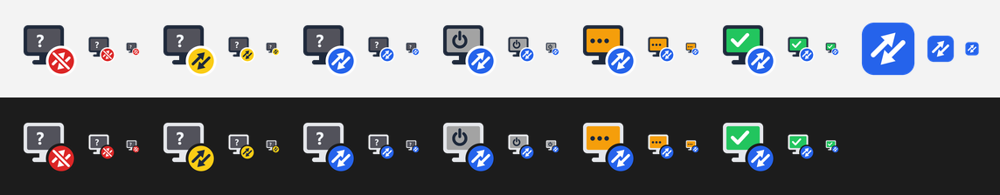

# HomeLink tray design

The tray interface was designed as one system: the icon, the right-click menu, the
tooltip, the confirmation dialog and the notification texts. This document records the
design as implemented. The designer's original renders are in
[`design/reference`](design/reference).


## Icon

The monitor shows the home PC, the round badge shows the tunnel. Each PC state has its
own screen colour and glyph, so the icon reads without relying on colour alone.

| PC state | Screen | Glyph |
| --- | --- | --- |
| online | green `#22c55e` | check mark |
| waking | amber `#f59e0b` | three dots |
| off | grey `#a3a3a3` | power symbol |
| unknown | dark grey `#52525b` | question mark |

| Tunnel state | Badge | Glyph |
| --- | --- | --- |
| connected | blue `#2563eb` | two opposing arrows |
| connecting | yellow `#facc15` | two opposing arrows, dark |
| off | red `#dc2626` | arrows struck through |

Without a tunnel the PC state cannot be known, so only six combinations are distinct.
The twelve file names `<pc state>_<tunnel state>.png` are kept; for a tunnel that is off
or connecting, the `offline`, `waking` and `online` files are copies of the `unknown`
ones.

There are two built-in sets: a dark monitor body for a light taskbar and a light body
for a dark taskbar. The program picks one from the Windows taskbar theme.



The application icon repeats the tunnel glyph: white opposing arrows on a blue rounded
square.

All shipped icons are drawn by `tools/generate_icons.py`.

## Menu (right click)

Three groups separated by lines: the tunnel, the home PC and Remote Desktop. The state of
the tunnel and of the PC is part of the item text.

```
Status                      bold; also the left-click action
──────────
Tunnel: <state>             check mark while connected; click connects or disconnects
──────────
Home PC: <state>  ▸
    Wake                    enabled when the tunnel is connected and the PC is not online
    ──────────
    Sleep                   enabled while the PC is online; asks for confirmation
    Shut down               enabled while the PC is online; asks for confirmation
──────────
Open RDP                    enabled while the PC is online
──────────
Settings
Quit
```

## Left click

Shows a message box with the program version and the state of the tunnel and of the PC.
It changes nothing.

## Tooltip

Two lines, the tunnel first because everything else depends on it:

```
Tunnel: connected
Home PC: online
```

## Confirmation dialog

A standard Windows message box titled `HomeLink` with a question icon and Yes / No
buttons. The default button is No, so an accidental Enter does not turn the PC off.

## Notifications

| Event | Title | Text |
| --- | --- | --- |
| PC answered after a wake | Home PC is available | You can open RDP. |
| Sleep command sent | Sleep command sent | The home PC is going to sleep. |
| Shutdown command sent | Shutdown command sent | The home PC is shutting down. |
| PC did not answer in time | PC is not responding | The wake-up was not confirmed in the allotted time. |
| Tunnel failed to start | Failed to bring the tunnel up | Reason: … |
| Wake-on-LAN failed | Wake-on-LAN error | Reason: … |
| Power command failed | Failed to run the command | Reason: … |
| Tunnel dropped on its own | Tunnel is off | The connection to the home network was lost. |
| PC stopped answering on its own | PC is unavailable | The home PC stopped responding. |

The last two are sent only for changes the user did not ask for: disconnecting the tunnel
from the menu, or a PC that goes offline after a sleep or shutdown command, stays silent.

## Differences from the designer's handoff

- **Top menu item.** The handoff keeps "Connect and wake" as the bold default item and
  the left-click action. Left click was judged too easy to trigger by accident, so the
  default item is "Status", which only displays information. Waking is done from the
  "Home PC" submenu.
- **Tunnel item while connecting.** The handoff disables it. It stays enabled, except
  while another action is running, so that a tunnel stuck in "connecting" can still be
  disconnected.
- **16 px icon.** The handoff draws the smallest size separately, without the screen
  glyph. The program hands Windows one 64 px image and lets the system scale it.
- **Dark taskbar set.** The handoff mentions it as optional; it is implemented and chosen
  automatically.
